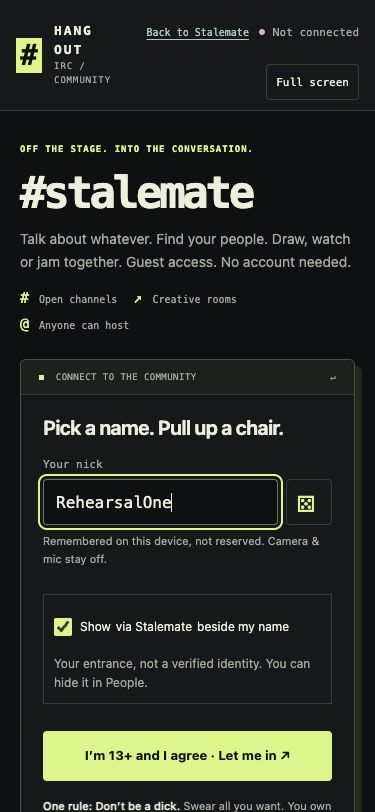
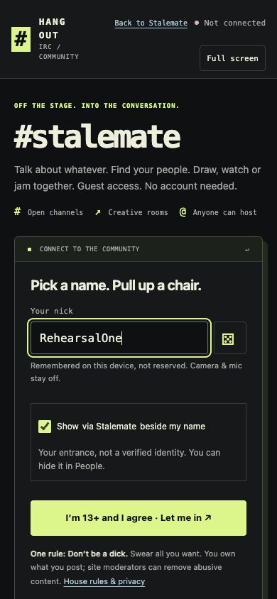

# Private release candidate: current handoff

**The reviewed private website update is delivered; full band rehearsal
acceptance is still pending.** The latest checkpoint below supersedes older
runtime and ownership statements. This handoff preserves all
[62 acceptance requirements](HANGOUT_ACCEPTANCE_REQUIREMENTS.md). It is not a
public-launch approval. This work leaves both public websites unchanged.

## Latest delivery and rehearsal checkpoint — November 9

This WebJam session owns independent application work, normal GitHub CI/PRs and
remaining private delivery/testing. Jeff explicitly kept StoryPool separate:
do not route this work through its bus, Karen, conductor or shared services.
Earlier Grok-delivery and Dot-ACK instructions below are historical. Resource,
trust, configuration, privacy, spending and existing release/provider holds
remain binding.

| Layer | Observed evidence | What it does not prove |
| --- | --- | --- |
| Private website | Reviewed runtime `c83dfaff1fe924ea0a70cfc902731234113f0c09` now serves as version `49f19821-e3cf-4699-8698-3dd3f446ca3b` at 100%, deployment `113a1d31-e071-40f1-9101-6f45918a8a85`; `f19dbee75842ddde59594dcd45fd9305af0cba71` adds readiness documentation only | Normal invitation admission and the current prejoin screens are now qualified below; joined chat, remaining frontend readback and media are pending |
| Worker/configuration preservation | Downloaded serving Worker SHA256 `9fefc1a13eaecb138be633e85d19039c15969f7066b7e71b6123636858493b78` matches the qualified bundle. All 17 plain variables, five secret-binding names, five Durable Object namespace IDs, asset binding, runtime and effective service settings were compared with the private live snapshot | `--keep-vars` alone would not establish these comparisons; no secret values belong in this repository |
| Private issuer | `fd37578f-13cd-4fce-b557-35c0d962ef9d` remains at 100%, deployment `77728fdf-5fb7-4a8a-bdf5-b6a7467f0bf3`; the one completed 405/204/403 qualification has receipt SHA256 `c209b961bd8b64e7b2e812c00e33f0f9623f7d2e45fee06ecd992fe2f5b6584e` | Do not rerun completed issuer negatives or mint test credentials |
| Rollback | Previous site `2c5c81e5-1aa4-4ea7-be69-cacda13c20e8` and issuer `4db649fa-a465-44b4-8487-414987b3a660` are retained; no rollback was needed | A later rollback still needs the normal guard and effective-configuration preservation checks |
| Intel and Apple Silicon apps | Actual package source remains `533514d678c0e210c3e7817302605093d6a1e005`. Both Mac archives passed strict nested signature checks; installed Intel and Mini startup/invalid-invite recovery were exercised | Ad-hoc signatures are not notarization or Windows trust proof; current ARM hosting and current physical music remain unverified |
| Shared Track | The actual ARM GUI loaded the rights-cleared WAV, replaced it with MP3, displayed 48 kHz/stereo/40 seconds and removed it. Play/pause/restart/seek correctly stayed locked without a verified live primary route | File decoding and locked controls are not live playback, remote hearing, mix/level/mute or transport-control proof |
| MacBook readiness | At 05:18 UTC it was reachable, with 24.4 GiB free, zero swap, load 2.65 and no WebJam/Jamulus components. Default built-in microphone and wired External Headphones were both 48 kHz; BlackHole 16ch was present at 48 kHz | Device availability does not certify the active primary/backing routes; do not reinstall BlackHole |
| Webex | The verified Mini client supplied the existing Personal Room. Its link was saved through normal WebJam Settings and survived reopening, with the musician name unchanged; no meeting opened | Only the Mini preference was qualified. MacBook setup, actual video/speech and the exclusive audio handoff still need the attended check |
| Ordinary private entry | The existing local invitation bookmark was opened normally in Safari and Chrome; both accepted it without email or a new invitation key. Both reached the same lobby path with their Stalemate/Rad Dad source choices and return links | The agreement click is awaiting action-time approval for two test guests. Neither has joined the chat/socket or started media; no full newcomer journey is claimed |

The serving Worker differs from the previously qualified backend only by the
removed source-map footer; all other bytes match. The earlier config-location
and raw-hash expectation stops remain recorded as stops. They were qualified
against the saved artifacts, not relabeled as initial passes. The 70-file
protected asset manifest has SHA256
`4bd4a075d66d8ad7f2cd4f4e596b41a29418153015bef4927f2d7af62abdf2f1`.
Private operational receipts remain in the application workspace; never commit
their raw configuration, provider output or private links.
The [sanitized delivery receipt](../pr-assets/beta-collaboration/20261109/private-delivery/receipt.json)
records the exact serving identities, code/configuration comparisons and guard
summary without those private values. It explicitly leaves admitted-user and
media acceptance pending.

### Current admitted prejoin and mobile evidence

The [sanitized prejoin receipt](../pr-assets/beta-collaboration/20261109/admitted-prejoin/receipt.json)
binds actual 375×812 and 390×844 Chrome screenshots to the delivered candidate.
Both had page width equal to viewport width, contained nickname controls and a
16px nickname input. This is prejoin reflow evidence, not a physical iPhone,
joined message composer/chips, chat or media pass. The source choices remained
ordinary guest context, not verified identity. No agreement, chat connection,
microphone or camera was activated by these checks.

| 375px | 390px |
| --- | --- |
|  |  |

The browser-exported favicon matched reviewed bytes exactly. The stylesheet
export initially differed: the export tool had decoded UTF-8 as Windows-1252
and re-encoded it. Reversing that transformation reproduced the reviewed CSS
byte for byte, and the actual browser rendered the Unicode glyphs correctly in
UTF-8. The original mismatch is retained separately; this qualification is not
a raw HTTP stylesheet-byte capture. Raw JavaScript response hashes are still
unverified by this browser export. A first viewport request targeted a different
window that remained 1200px wide; its desktop image is retained locally and is
not counted as mobile evidence. The corrected controlled tab reported the
requested widths before the two mobile captures; its override was reset.

Billing admission for October 15–November 14 reported 1,000 GB included, 0.01 GB
used and $0, with the 800/200 caps and relay-cap hold unchanged. Approximately
999.99 GB unused is a derived, rounded figure, not an exact real-time balance or
a future-cost guarantee. Fresh applicable headroom, resource and hold checks
are still required before a bounded media trial. The approved private Mini
delivery gate is swap below 90%, load below 10 and at least 15 GiB free; stricter
application/device test guards must not be silently replaced by that gate.

### Next essential band journey

1. Enter using the existing invitation, choose a nickname and check ordinary
   IRC chat, source badges and room creation on the delivered frontend.
2. Use one Mac native host and one Windows browser guest for at most ten
   minutes after normal admission checks. Verify two-way speech/music,
   leave/rejoin/recovery and cleanup. Che does not need the desktop client to
   join as a browser guest; native Windows trust remains a separate question.
3. Exercise actual WAV then MP3 Shared Track playback through its certified
   separate BlackHole route, while the primary input/output remain physical.
   Verify audible backing plus musician mix, levels/mute, pause/restart and
   cleanup. Generated tones and offline decoding do not substitute for hearing.
4. Test Webex video and the manual Music → conversation → Music handoff with
   consenting participants and no recording. Disconnect meeting audio at both
   ends while playing; microphone mute alone can leave meeting playback on.
   Leave/end Music before connecting meeting audio. Disconnect meeting audio
   before returning, then create a fresh Music invitation. WebJam does not
   control or verify the external meeting's audio state.

[WebJam #458](https://github.com/rupret007/webjam/pull/458) merged as
`de89a1e95f03c302f3a6c47aa8ac2f4956e620b2` after normal CI and corrects the
meeting-audio documentation. It changes no native runtime. The subsequent
[panel-copy fix #459](https://github.com/rupret007/webjam/pull/459) merged as
`e7e0b46d1bcbd57bd429a4f73d6f49260bbe72dd`, from reviewed head
`256e13480eb07836e81b0577902580b06e2e9f5e`. Its final source CI passed
12,955 Python tests, 69 browser tests and both real Jamulus integration suites.
It is not in the selected 533 package. The review retains the original stale
Art-to-Music and audit-test wording failures and their corrections, alongside
the focused results. Initial source CI download failures were retained too;
full GETs and pinned hashes established upstream recovery before bounded
failed-job retries passed. Those source checks are complete and should not be
repeated. They do not establish that the selected app contains the new fix.

The private artifact run `42575447417` builds that exact 256 head with the
private-beta target, signing/certification off and no public release. Windows,
Apple Silicon and Linux packaging passed. Intel packaging stopped at the pinned
Jamulus 3.12.2 disk-image download with HTTP 504; an independent full GET also
returned 504. No retry has been admitted without upstream recovery. Preserve
the successful jobs and original failure; never weaken the asset pin.
The actual Apple Silicon archive passed local exact source/target, component
checksum, architecture and deep/strict/all-architectures signature checks in
an isolated cache. No installer, app, media or quarantine override was run.
Two local inspector stops (an app-only archive expectation and an unavailable
metadata API) were corrected against the same downloaded/extracted bytes;
their original receipts remain retained. None is a physical host or hearing
pass, and the selected demo has not changed.

The [concrete website entry package](HANGOUT_WEBSITE_ENTRY_HANDOFF_20261109.md)
is now available for the receiving website session, with its downloaded CI
artifact and independently checked source/payload hashes. Both public
entrances remain unpublished. The separate command-line frontend readback
stopped before admission at Cloudflare 403/error 1010, and opening the raw
script as a browser document was blocked by the client. Neither protection was
bypassed. The normal browser prejoin remains admitted, but raw served
JavaScript/stylesheet HTTP hashes are still unverified.

All 62 requirements remain in force, including Art/Bob Ross/Grandeur-first and
custom YouTube, mobile/accessibility, capacity, platform, moderation and public
operator/legal work. A successful private rehearsal will not itself complete
those broader outcomes. Keep both public entrances unpublished.

## Historical device and delivery checkpoint — November 9, 00:57 UTC

At the time, this checkpoint superseded the older device/setup statements below. The earlier
sections remain dated evidence; they are not instructions to repeat completed
downloads, install helpers, GUI checks or CI.

| Layer | Verified current state | Next required evidence |
| --- | --- | --- |
| Reviewed private website | PR 243 merged as `c83dfaff1fe924ea0a70cfc902731234113f0c09`, tree `7ca20bdcda674a4c70601ec1ff68708a50da8431`; UI fixes and source-bound screenshots retained | Receiving-owner private delivery, effective-configuration preservation and served-asset readback |
| Actual private website | Version `2c5c81e5-1aa4-4ea7-be69-cacda13c20e8`, deployment `e75182dd-8ac7-484a-809b-a80f6a8ac52e`, 100% at 00:57 UTC | The reviewed UI candidate is still not delivered at this readback |
| Actual private issuer | Version `4db649fa-a465-44b4-8487-414987b3a660`, deployment `618e7517-42e1-422a-8449-5d04a2ecada0`, 100% | Receiving owner delivers merged WebJam #454 (`da47b27b164d0114480c76c6f5280c1669128a7c`) through its normal private path |
| Installed Intel demo | Package source `533514d678c0e210c3e7817302605093d6a1e005`; Desktop demo selection, strict nested Mac signatures and real GUI invitation recovery verified | Current Mac-to-Windows speech/music, actual Shared Track WAV/MP3 and Webex handoff |
| Apple Silicon package | The existing 533 ARM archive passed actual Mac signature/component checks and is saved in the MacBook cache | ARM installation/host role under an admitted resource guard; no execution on the Intel Mac is claimed |

MacBook Accessibility now works. The installed Intel GUI rejected a genuinely
malformed invitation, displayed recovery guidance, masked input, cleared it on
Back and restored Host/Join. That successful check requested no media or
clipboard access. Its report SHA256 is
`e5f9bc23ce76fa46ef9d6e67e2a5df6d14aedb654ef0c5fa704ba8ce0d750c09`.
The original DNS-shaped dummy was a valid legacy endpoint and did start a join
attempt before timing out; it is not an invalid-invitation or media-free pass.
Whether capture briefly opened during that original attempt was not proved.

The reusable developer checker merged in
[WebJam #456](https://github.com/rupret007/webjam/pull/456).
[Follow-up #457](https://github.com/rupret007/webjam/pull/457) merged as
`b012a01b28a6939d69f1bdacbc56ec7f1cba03a1`: an existing report is preserved
without a path-bearing traceback, and invalid PID failures produce a complete
STOPPED report. Its eight focused tests and the actual installed-GUI check
passed. Normal CI on tested checkout `642a74578bb5735def6be342f3bb60f5ab2a0685`,
tree `7c3e1b158b431a164f34e3b06dc6765630459555`, passed 12,949 Python tests
(60 skipped, 564 isolated module groups), 69 browser tests and both real
Jamulus 3.12.2/3.12.3 integrations (11 RPC plus 7 boundary cases each), along
with the normal Worker, security and diagnostic checks. Both PRs change QA
tooling/documentation, not the native runtime: **do not rebuild 533 for them**.

Jeff subsequently quit an unexpected Music session. At 00:54 UTC, SSH process
readback found no WebJam, Jamulus or JamulusServer remaining on the MacBook.
The earlier session's owner is unconfirmed. This cleanup is not a listening,
Shared Track or meeting pass; leave the application stopped until the next
qualified trial.

The existing account entitlement API returned `calls.enabled=true`, but no
numeric allowance/headroom. The billing-usage API returned 403 with the existing
credential. Neither result establishes room for another media trial. The
existing relay-cap marker is unchanged. The Mini guard is still closed
(00:57 UTC: swap 87.565%, root free 16.133 GiB); no guard was relaxed.
Jeff forwarded the [private delivery handoff](https://github.com/rupret007/StalemateSite/pull/243#issuecomment-6728954777)
to Grok. Owner acceptance and delivery still require actual readback; forwarding
alone is not deployment evidence. Preserve settings, secrets, namespaces,
origins, caps and holds; do not infer current configuration from defaults.

The release candidate remains pending. All 62 requirements, current physical
audio/video and Shared Track acceptance, platform/accessibility/capacity work,
and public operator/legal decisions retain their original scope. Source CI,
generated audio and historical human results do not replace these outcomes.

## Earlier application candidate — November 8, 20:02 UTC

**Checkpoint: November 8, 20:02 UTC; deployment readback 19:48 UTC.**

The private application branch `codex/owner-tools-late-metadata-20261104` now
contains [PR 241](https://github.com/rupret007/StalemateSite/pull/241) and
[PR 242](https://github.com/rupret007/StalemateSite/pull/242), merged in order as
`5bbddaa6a2d729cf9ae21b824c258e548ec8d516` and
`844a32850d5a68c741b393e25b6ad11ba9b64890`. The final reviewed/merged tree is
`992a18759df2055d7b29fc5496fc2cda30305ce0`. **These changes are not deployed.**

The Jam room now shows two startup steps to its current host, followed by the
invitation field and Share. It explains that Mac and Windows browser guests
need no native installation. Guidance follows actual operator changes and
hides after sharing. The second fix keeps the full message input visible when
Tab moves focus to Send at deep browser zoom.

Both current-head push and PR runs passed without retries: 2,091 unit tests in
138 files, 853 browser cases for #241 / 854 for #242, and both 34-case smoke
suites. Final source runs are
[42511690738](https://github.com/rupret007/StalemateSite/actions/runs/42511690738)
and [42511696731](https://github.com/rupret007/StalemateSite/actions/runs/42511696731).
Actual checkout trees match the merged tree. Automatic final-branch run
[42515682918](https://github.com/rupret007/StalemateSite/actions/runs/42515682918)
was still running at this checkpoint. The intermediate #241 merge run was
normally cancelled as superseded. Original test failures and retry evidence
remain retained: the new host test initially sent an invite before Jam
admission; it now waits for admitted host guidance.

Installed Windows Chrome verified host layouts at 1440×900, 375×812 and
390×844 and a separate guest at 390px using a local frontend preview over the
protected backend. Real Chrome 400% Page zoom independently reproduced and
fixed the keyboard focus defect at a 320×232 CSS viewport. The passing preview
kept input bottom at 229.25px and Send at 222.25px, with no horizontal overflow.
This is preview evidence, not deployed-candidate or physical-iPhone evidence.
Owned rooms, guests, profiles and processes were cleaned up; no media capture
or external provider request occurred.
See the [source-bound screenshot manifest](../pr-assets/beta-collaboration/20261108/private-ui-candidate/manifest.json),
[375px host](../pr-assets/beta-collaboration/20261108/private-ui-candidate/host-375.png),
[390px host](../pr-assets/beta-collaboration/20261108/private-ui-candidate/host-390.png)
and [actual 400% zoom](../pr-assets/beta-collaboration/20261108/private-ui-candidate/composer-real-400-percent.png).

A read-only provider check at 19:48 UTC still found website version
`2c5c81e5-1aa4-4ea7-be69-cacda13c20e8` and issuer version
`4db649fa-a465-44b4-8487-414987b3a660`, each at 100%. WebJam's merged
[issuer fix #454](https://github.com/rupret007/webjam/pull/454) still awaits
the deployment owner. Before owner delivery, freshly reconcile actual effective
settings, approved origins, bindings, namespaces, secrets, caps and holds;
read back candidate assets afterward. Keep both public entrances unpublished.

| Layer | Current qualification | Still required |
| --- | --- | --- |
| UI candidate | Merged source, clean CI and actual Chrome previews | Receiving-owner delivery and exact served-asset checks |
| Native refresh | Private-beta source `533514d678c0e210c3e7817302605093d6a1e005`; 12,941 Python tests passed, 60 skipped | Finish platform trust/device checks before staging; Windows/Linux artifact downloads remain unverified |
| Actual device candidate | Previously staged Intel/ARM packages remain source `76b1fd74c0f8a77df2c9d6b42f7fde87dadfaf7c` | Current desktop GUI speech/music, Shared Track WAV/MP3 and route/hearing checks |
| Webex | Existing dedicated Personal Room found through verified client UI | Save through WebJam settings; real video and manual exclusive-audio handoff |
| Broader acceptance | Existing scoped lobby, Paint Along and generated-media results retained below | Outstanding physical, moderation, platform and public operator/legal requirements |

The native refresh uses existing private-beta
[run 42513422718](https://github.com/rupret007/webjam/actions/runs/42513422718).
All four desktop packaging jobs passed, including their frozen lesson player
and Reference Studio checks. The complete run concluded success on attempt 1.
The Intel archive was independently downloaded and matched GitHub artifact
`13631463876`, SHA256
`523ebd3012c034247f9caecb4154df357e379fc2429b77e4a7684c09fc6b61f4`.
Its nested application ZIP is SHA256
`e4a16a1b5a6304d9287f4d3241ceb611dadd80d92faab7ba0dc38759a2858e66`.
An isolated Windows cache check verified contained archive paths, source build ID,
canonical private-beta manifest, target CPU, codec hash and transport/headless
checksum manifests. The bundled installer helper bytes matched reviewed source;
no helper or packaged executable ran. The original inspector rejected expected
packaging extras and the standard two-field headless checksum format; its failed
receipt was retained, and a separate read-only check verified the same saved
archive without downloading it again. The ARM archive also matched GitHub artifact `13631806005`, SHA256
`338f4d4596c28c4ced0eeef97631ee1b2396a9da661bcd156cb37f415b745ce6`;
its nested ZIP is SHA256
`f9460377ba6d4040ec8fab5860fe53b7512c6146969e6856be5f5f95363b52da`.
The same build/target, path, architecture, source-helper and component checks
passed there on the first attempt.
Independent Mac signature checks, staging and physical acceptance remain pending.
A separate readback verified both saved archives and parsed receipts, with
resource guards passing before/after and PowerShell still Restricted. See
[the sanitized artifact receipt](../pr-assets/beta-collaboration/20261108/private-ui-candidate/native-artifact-evidence.json).
No installed application changed. Windows
remains unsigned and trust-blocked for this device setup; its browser role
needs no native install. Packaging does not prove live musical performance,
desktop Shared Track audibility or an actual Webex meeting.

All 62 acceptance requirements remain unchanged. MacBook onboard mic/speakers
are authorized for low-volume checks, separately from headphone music
acceptance. The Jabra is charging on the Mini. Resource and access checks still
precede device sessions. StoryPool/Karen, shared infrastructure and deployment
ownership remain outside this application session.

## Latest deployed private update — November 8, 08:45 UTC

The current private Worker is **`2c5c81e5-1aa4-4ea7-be69-cacda13c20e8`**,
100% deployment `e75182dd-8ac7-484a-809b-a80f6a8ac52e`. Reviewed website
source `71bff2cd6a5e352492eb7aaa304385182b378652` was merged through
[PR 239](https://github.com/rupret007/StalemateSite/pull/239) as
`76ccf7b14c5a13943e1750a56fac3d79611eb387`, tree
`3236c54ac2c0418e3d0469b717a38dadfbaf952c`. Its Web Join import is exactly
`84193760a0d10050a649d0872151c30637997c63` from
[WebJam PR 453](https://github.com/rupret007/webjam/pull/453).

This fixes a demonstrated dead end: an invalid invite previously told people to
tap a hidden Retry control. It now asks for a fresh complete browser invitation
and hides unusable Join/Retry/Leave and prejoin controls. A valid fresh link still
shows the compact audio check with Join visible and disabled until its normal
requirements are met. Parsing, cryptography and media behavior are unchanged.

Both website CI runs passed **2,091 units / 138 files, 851 browser cases and
34 + 34 smokes each**. The upstream browser CI passed **69 cases**; all three
upstream exact-head runs passed. Full raw logs and actual source trees were
reviewed before merging. Website/browser CI remains separate from the explicit
workerd provider-start mode qualified below.

The private update changed only `join/app.js` and its provenance. Its actual
Worker JavaScript SHA256 remains
`12280eb44c9893200a699badda53226b80ab8a5b5b953292bfacc7f843df3ee8`,
and all 66 backend source contents match the earlier 449 baseline. Effective
settings, namespaces, issuer and cap marker were independently rechecked after
delivery. The Mini's compile/upload guard was closed, so the exact candidate was
dry-built and delivered from a separate Windows application cache with its
actual memory/disk, signed Node and Restricted-policy guards. No StoryPool,
shared services, public site or guard override was involved.

Installed Windows Chrome 156 verified all fourteen served runtime asset hashes,
ordinary private guest admission, six missing/malformed/expired-link cases at
375/390px, and two valid-link prejoin cases at those widths. All eight screenshots
were read back by hash and visually inspected. Text wraps, no page overflow was
observed, and valid Join remains fully visible. Capture requests and external
requests were zero. Logout returned 200 and original/copied cookies then
returned 401. A separate readback confirmed the owned process/listener/task gone
and PowerShell still Restricted. See the
[hash-bound recovery packet](../pr-assets/beta-collaboration/20261108/invalid-invite-recovery/manifest.json).

**The release candidate is still pending.** The earlier full lobby, heartbeat and
generated music evidence below remains scoped to version 449; do not relabel it
as a new complete end-to-end test. The staged native package is still source
`76b1fd74c0f8a77df2c9d6b42f7fde87dadfaf7c`. Current human Mac-to-Windows
speech/music, desktop WAV/MP3 Shared Track, Webex video/manual exclusive audio,
and the remaining operator/platform checks below are not completed by this UI
fix. Webex's existing Personal Room was subsequently found through its normal
client UI; saving it through WebJam settings and real meeting acceptance remain
pending. No meeting or capture was started by that discovery.

## Provider-start CI dependency resolved

The originally requested command
`npm run --silent test:lobby-session-runtime -- --participation --provider-start`
actually ran in [CI run 42459839175](https://github.com/rupret007/StalemateSite/actions/runs/42459839175),
job `128666554107`, on the equal-tree checkout of source `b504bd5`. Its full
retained log and actual command/result were inspected. All **51 source entries**
and **68 compiled bundle inputs** match current deployed source `71bff2c` and
the matched installed dependency bytes. This is input-bound reuse of that real
CI result, not a newly dispatched full-tree test on `71bff2c`.

The mode proves the real workerd/SQLite owner, read-only transaction-before-start
ordering, Stop/revoke refusal, held-response progress, callback-close fence and
cold cleanup without replay. The first child was intentionally killed by the
existing runner; recovery exited zero, owned processes were absent and temporary
state was removed. Its two provider-start callbacks were inert. The separate
egress-probe counter was **one intercepted/denied call**, then zero after cold
recovery; do not relabel every counter as zero or claim external activation.

The [source-bound receipt](../pr-assets/beta-collaboration/20261108/invalid-invite-recovery/provider-start-current-inputs.json)
resolves the original eighth-mode request; older pending notes are historical.
A description of an additional “frozen native-provider” test does not redefine
that original command. This mode does **not** qualify frozen desktop audio,
real provider activation, guardian/legal decisions, hearing, Webex, capacity or
the other existing runtime modes by itself. Production AI remains off. Physical
music, Shared Track and Webex acceptance are still pending as described below.

## Earlier full lobby baseline — version 449

The browser lobby is ready for further private evaluation. Actual Intel Mac
WebKit and Windows Chrome checks on version 449 passed chat, both
entrances, reconnect, mobile containment and logout. Music still needs the
current Mac-host-to-Windows listening and instrument checks, desktop backing-track
playback and actual Webex handoff. Earlier human listening and generated-audio
successes have different build/platform scopes and do not complete those checks.

| Component | Exact identity |
| --- | --- |
| Earlier reviewed website source, [PR 236](https://github.com/rupret007/StalemateSite/pull/236) | `ac9b82f42c8d6952193f5cbefbf11fc04816821d` |
| Application branch merge | `84e77d6d8513a4f8ecce713835b97aa3a547b66c` |
| Identical source/merge tree | `7037bd7b5a4b32841af313402545256b5943053e` |
| Private Worker version | `449fe7d2-0ac3-41b8-b622-fda2453b38db` |
| Private deployment, 100% at readback | `9c793eb0-60a9-4c45-91b1-76cf3918ed61` |
| Deployed Worker JavaScript SHA256 | `12280eb44c9893200a699badda53226b80ab8a5b5b953292bfacc7f843df3ee8` |
| Imported Web Join source, [WebJam PR 452](https://github.com/rupret007/webjam/pull/452) | `5dde45d2e841fd19ff9c1fd055f88520fbf778e4` |
| Staged native packages, unchanged | `76b1fd74c0f8a77df2c9d6b42f7fde87dadfaf7c` |
| Unchanged private TURN issuer version | `4db649fa-a465-44b4-8487-414987b3a660` |

Delivery independently matched all 66 backend source contents and the compiled
Worker bytes. All 17 effective plain settings, secret binding names, namespaces,
issuer and existing relay-cap marker were preserved. Do not redeploy this
candidate just because an old preparation controller still exists. Its exclusive
delivery receipt records the completed attempt.

Application work proceeds independently of StoryPool/Karen, as Jeff requested.
Use isolated application worktrees and existing app CI. Do not change installed
StoryPool, shared services, CI workflows, conductor state or shared operational
files. Public release, AI, separate Hang Out chat/media TURN, trust controls,
spending limits and existing provider holds remain unchanged.

## Earlier version 449 results and their limits

| Evidence | Actual result | What it does not prove |
| --- | --- | --- |
| Exact-source application CI | All three pre-merge and four automatic post-merge runs passed; full raw logs and actual checkout trees reviewed. Each main job reports 2,091 units in 138 files, 821 browser cases and 34 + 34 smoke checks. Pages deployment was skipped. | Physical listening, hosted provider-start or a new native binary. Native runtime CI modes remain distinct from the separately requested native provider-start mode. |
| Current Intel Mac SDK WebKit 27.2 | Twelve hosted stages; fourteen served runtime assets matched. Both branded guests chatted, a reconnect retained a private draft with fresh scrollback, Art guests shared a stroke, host/guest topic permissions differed correctly, inert Jam invitations shared, own rooms closed and both logouts revoked copied cookies. | Physical Safari/iPhone, real microphone, live music or YouTube playback in this run. |
| Current Windows installed Chrome | Seven hosted stages; fourteen actual runtime assets matched. Both entrances, reciprocal source badges, fresh join, reconnect, simulated mic-denial recovery and logout/revocation passed. | Actual microphone permission/device routing, speech, instruments or a native Windows install. |
| Four current mobile viewport screenshots | Mac and Windows at 375/390px were inspected. Page width equals viewport width; text wraps; input and Send are contained; inputs measure 16px. Starter/action rows scroll inside their own rows. | A physical iOS keyboard, screen-reader speech or full WCAG 2.2 AA. At 375px the Windows header wraps; trailing row controls require horizontal scrolling. |
| Owned-resource cleanup | Separate readbacks matched the same browser proofs/harnesses and confirmed owned test processes gone. Windows listener/task were absent and PowerShell remained Restricted. | Changes to or validation of unrelated user processes/services. |
| Original repaired eight-hour expiry, previous C227 runtime | Completed at `2026-11-08T01:16:39.482Z`. Original and identical expired signed-cookie requests and protected code all returned 401; actual socket ended with 4401. Owned observer and awake assertion independently gone. | An eight-hour run on current version 449 or uninterrupted uptime. Five recovered abnormal closes occurred during this baseline. |
| Current 110-minute hosted heartbeat observation | Completed `03:23:23.527Z` November 8: 10 actual ping/pong pairs, one socket open, zero closures, logout 200 and all browser resources closed. Same proof/harness and owned Node/awake exits independently verified. | An eight-hour current-version run, proof of the earlier disconnect cause, or a guarantee that heartbeats prevent every network disconnect. |

The original observer controller received an `HTTPError` during its final
metadata read after the browser passed. The automatic watcher then encountered
a missing-field `KeyError` and attempted no readback. Both original failures and
hashes are retained. An independent readback of the same completed browser
receipt verified exact proof/harness and process cleanup; a separate normal CLI
auth/read-only metadata check returned 200 for deployment, issuer and settings
and matched the unchanged cap marker. No browser, guest or observation was
restarted. The original HTTP status/response was not retained, so its precise
cause remains unassigned. Do not describe the original controller as a clean pass.

The [sanitized evidence packet](../pr-assets/beta-collaboration/20261108/current-private-readiness/receipt.json)
records source identities, receipt hashes, measurements and limitations. Raw
credentials, invitation values and recordings are excluded. The screenshots
contain synthetic test messages only.

Setup observations, with different timing boundaries:

| Endpoint | Stalemate | Rad Dad | Manual reconnect |
| --- | --- | --- | --- |
| Intel SDK WebKit | 955 ms | 916 ms | 325 ms |
| Windows Chrome | 3,223 ms | 1,080 ms | 283 ms |

The Mac timer starts at invitation submission; Windows starts before loading
the entry page and filling the invitation. Both include automated nickname
entry. These are individual automation samples, not a cross-platform speed
comparison, service-level target, percentile measurement or audio latency.
Human reading, typing and device setup will take longer.

The first Windows controller stopped before staging or browser launch; its cause
remains unknown. Read-only diagnostics confirmed no test source, profile, proof,
listener or task existed. After available memory recovered above the unchanged
2 GiB guard, one guarded continuation completed the first browser run. The
original stop was retained. A separate local command-size check also stopped
before remote execution; a duplicated check was removed without changing the
6,500-character command limit or the existing stage-before-write source check.
Neither event is silently relabeled as an initial pass.

The repaired C227 baseline recorded five 1006 closes with automatic reopen gaps
of 1,158–1,259 ms. Their cause and delivery during those gaps are unproven. The
final 4401 was observed 81 ms before nominal expiry on the Mac clock, within the
existing 1.5-second clock tolerance; this is not exact server timing. The new
heartbeat uses the existing prepaid/rate/lifetime limits and never renews
authentication. Source regression and native short-expiry checks remain separate
from the actual hosted observations. See
[the heartbeat design](HANGOUT_IDLE_HEARTBEAT_20261107.md).

## Earlier version 449 music and Webex results

A November 8 **current version 449 → installed Windows Chrome** generated-audio
trial passed. Over 40.386 seconds the browser detected all 160 tone windows:
54 E, 53 G and 53 A; it reported 2,083 packets received, 2,128 sent, zero lost and
zero disconnected windows. The native participant detected the return tone.
The path contained relay and server-reflexive candidates. The displayed 50 ms
estimate excludes capture and the native bridge; it is not acoustic latency or
proof of tight live rehearsal. Automated join-to-connected time was 14,125 ms;
generated-mic detection took 1,190 ms. These are single samples.

The countdown decreased normally, logout returned 200, and original/copied
cookies then returned 401. Separate readback matched proof/harness hashes,
confirmed owned Windows commands absent, port/task gone, policy Restricted,
all 32 native fixture sources and the WAV unchanged, and the native fixture idle.
The screenshot was visually inspected. This used generated input, muted browser
output and a synthetic mixer with packaged components: **no physical hearing,
actual desktop Shared Track mix, instruments or Webex was qualified**.

A separate Apple Silicon packaged-components → Windows Chrome generated trial
also passed on version 449: 40.294 seconds, all 160 tone windows, zero reported
lost packets and zero disconnected windows, with a native return tone. All
thirteen periodic resource checks passed and owned cleanup was independently
verified. Its displayed 75 ms estimate has the same limited timing boundary.
This is transport evidence, not a desktop host, Shared Track or hearing result;
the [sanitized PR 238 receipt](https://github.com/rupret007/StalemateSite/pull/238#issuecomment-6718684984)
retains the exact source, proof hash and original preparation stop.

The MacBook now has verified BlackHole 16ch at 48 kHz with physical built-in mic
and wired headphones as defaults. Its staged package/signature matched. The
production process-route API is available, but no active primary route or GUI
playback was proved. Virtual input devices were not counted as physical mics.

Webex remains in scope. Verified clients were found on the Mini and Windows;
the MacBook's production detector found no supported installation. Neither Mac
had a saved meeting link at that inspection. At 09:48 UTC, the existing dedicated
WebJam Personal Room was found in the signed Mini client's normal settings.
The private link was excluded from evidence and has not been saved into WebJam.
Recover it through that same UI when needed; do not ask Jeff for the URL again.
No meeting or capture was started. See [the Webex handoff](HANGOUT_WEBEX_AUDIO_HANDOFF.md).

Both private versions and effective settings matched in post-trial readback.
That controller then stopped on an assertion at the TURN analytics HTTP 200;
the response body was not retained, so its cause remains unassigned. The
original stop is preserved. A separate targeted analytics readback succeeded:
9,661,248 egress / 13,992,416 ingress bytes for October 15–November 8. Empty SFU
rows are not proof of zero usage or entitlement. The cap marker stayed unchanged;
no media trial was repeated to repair evidence.

[The new sanitized packet](../pr-assets/beta-collaboration/20261108/current-windows-music-webex/manifest.json)
binds these results, limitations and the connected screenshot. Existing earlier
failed trials and evidence remain intact. The release candidate is still pending.

## Shortest path to the remaining essential checks

No action is needed while Jeff is asleep. Do not repeatedly restart sessions,
request capture permissions or install audio drivers unattended. Resume with one
bounded test and retain its exact build, route, result and teardown together.

1. **Speech and music:** MacBook native host with built-in mic and wired
   headphones, Windows Chrome guest with a working headset. Recheck device trust,
   resource guards, actual current account allowance and unchanged cap hold
   before starting a one-host/one-guest trial of at most ten minutes. Hear speech
   both ways, then a short musical passage. For the actual band arrangement,
   use Jeff's SSL 2+ with guitar/vocal inputs and Che's drum interface when its
   model and channel mapping are known. An empty interface cannot prove music.
2. **Desktop Shared Track:** BlackHole 16ch is now installed and verified at
   48 kHz on the MacBook; do not reinstall it. Prove the active process route and
   actual GUI playback when Jeff is awake. Keep the real musician input/output as
   the primary route. BlackHole supplies the separate
   backing client, not the primary mic/guitar. Use a short rights-cleared WAV;
   hear it at the remote guest, check level/mute, pause/restart and clean ending.
   Then check MP3 through the packaged decoder. Follow
   [the Shared Track setup guide](HANGOUT_SHARED_TRACK_NEXT_CHECK_20261107.md).
3. **Webex:** recover the already identified dedicated Personal Room through
   the verified client's normal UI and save it through WebJam settings. Do not
   request its private URL again or copy it into evidence. After
   baseline audio passes, open that meeting externally
   with explicit microphone/camera consent. Verify video and the documented
   manual switch between meeting audio and WebJam. Never play both paths at
   once. There is no embedded web meeting or automatic cross-app mute. See
   [the manual handoff](HANGOUT_WEBEX_AUDIO_HANDOFF.md).
4. **Second network:** repeat the bounded core trial on a hotspot or Che's
   connection when available, recording the actual candidate path and dropouts.
   The production privacy filters deliberately exclude host/LAN/Tailscale
   candidates; sharing Wi-Fi does not establish direct media. Do not open router
   ports or weaken candidate filtering to manufacture a direct-path result.
5. **Human moderation:** Jeff's real moderator session must review and dismiss
   only the identified harmless acceptance report. Do not automate a dismissal
   and describe it as human review, punish a test nickname or touch other reports.
6. **Broader use:** complete the remaining registered-room recovery, physical
   mobile/accessibility, capacity and operator checks in the acceptance audit.
   Existing generated audio, local load and automated semantics remain useful
   evidence within their stated scopes.

The Windows participant can use Chrome without installing the native client.
Native Windows remains unsigned/trust-blocked; do not bypass policy or purchase
signing. Linux browser generated-audio and package/CI results do not establish
attended Linux native music. Intel and ARM packages are verified artifacts;
each physical host role still needs its specified route/listening qualification.

## Integration and operations handoff

Use one canonical community, directory, identity and moderation model. The
staging entrance URLs contain no invitation:

- `https://stalemate-hangout-beta.jeffstory007.workers.dev/beta/?via=stalemate`
- `https://stalemate-hangout-beta.jeffstory007.workers.dev/beta/?via=rad-dad`

The badge is arrival context, not identity or permission. A plain link needs no
website credential or cross-domain cookie. Keep `referrerpolicy="no-referrer"`
in the supplied link snippets. A neutral future-site link can reach the same
community; optional branded registration requires verified domain control,
exact origins/scopes and revocation. Do not add wildcard registration.

The existing source-bound entry toolkit payloads are unchanged by this runtime
update; it is an entry package, not a complete backend or credential export.
Use [the website integration guide](HANGOUT_WEBSITE_INTEGRATION.md), preserve
each website's newer content and validate both actual staging links before
any separate public release decision. No public navigation was inserted here.

Before delivery or rollback, read actual deployed source/settings, preserve
namespace IDs, stable keys, explicit effective variables, approved browser
origins, admission versions, incident pauses, issuer and caps. `--keep-vars`
alone does not preserve all plain settings. Do not copy tracked empty defaults
over the effective configuration or reset a hold to recover from a failed test.
The previous C227 source `d8c08fb` has the measured expiry repair but lacks the
new heartbeat and browser cleanup. The older `33862058` version has the known
idle-expiry defect. Neither is a blind rollback recommendation. Resolve an
unknown delivery outcome by readback before considering another attempt.

Operator contact and initial reviewer remain Jeff. One inbox is not continuous
moderator coverage. Jeff and his bandmates operate personally in Texas; all-ages
participation, guardian/privacy paths, applicable reporting/takedown duties,
retention and qualified legal assessment remain public-launch blockers. Keep
the existing private admission/camera guards, AI off and no default recordings.
See [privacy and incidents](HANGOUT_PRIVACY_AND_INCIDENTS.md). No compliance
claim or new legal advice is established by this engineering evidence.
