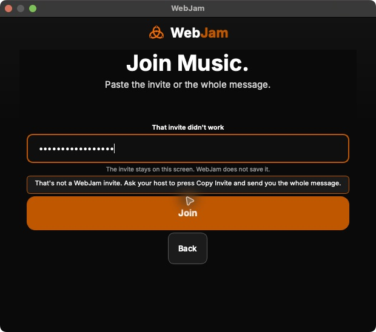

# Actual ARM launcher accessibility observation

This is a normal frozen-app observation on the ARM Mac mini, not an offscreen
fixture or a physical music result. The source83 package and production
transport checks are in the [candidate receipt](HANGOUT_NATIVE_CANDIDATE_20261031.md).

## Observed behavior

The fresh05:51:27UTC resource guard admitted launch. Before input, the actual
kernel executable for PID95277 matched the verified staged app; its embedded
source was `83d2950b5f95baa183c392bb7b5eb2da4a496114`. The normal launcher had
Music selected. Choosing Join, entering `webjam://join?v=1` (missing its host)
and choosing Join retained the launcher and displayed a recovery explanation.
No workspace, microphone/camera capture, provider or recording was started.

The corresponding [unmodified native accessibility snapshot](../pr-assets/beta-collaboration/20261031/native83-malformed-join-ax.txt)
exposes “How to join,” “Join status,” “Invitation privacy” and “Join error.” It
omits the visible status, privacy reminder and useful error explanation. The
invitation field remains a secure field with a masked value. This is a real
accessibility defect even though the functional refusal worked.

## Application correction and remaining proof

[WebJam PR408](https://github.com/rupret007/webjam/pull/408), reviewed source
`f22e1ba8d9b8a959ad3b90417080ec643192db25`, lets Qt derive text-label names from
their current visible content. Regression checks query `QAccessibleInterface`
through instructions, status, malformed Join, editing and retry in all four
creator profiles, including private-invitation non-disclosure. This follows
[Qt's accessible-name guidance](https://doc.qt.io/qt-6/qwidget.html#accessibleName-prop).
PR408 merged as `a62f01f40fc5fb71c2b901ad433dc73ed85c8593`. Its actual CI
checkout, reviewed head and merge have the same tree. All550 tracked test
modules ran once:12,626 passed,60 skipped, zero failures/errors/xfails/deselections;
all four new accessibility-profile journeys passed. All14 applicable checks
passed. The [source-bound CI receipt](../pr-assets/beta-collaboration/20261031/native408-accessibility-ci-receipt.json)
links the actual run and retains the raw-log digest. Local application Ruff and
compileall passed; local Qt runtime tests were not run because that environment
has no PySide6. The subsequent [actual bb40 frozen-app observation](HANGOUT_NATIVE_PACKAGE_BB40_20261031.md)
now demonstrates the full macOS accessibility explanation, editing and keyboard
retry. It has its own screenshot/snapshots; the original83 failure below remains.
No VoiceOver or comprehensive screen-reader qualification is claimed.

[Windows application PR409](https://github.com/rupret007/webjam/pull/409) retains
this merged fix and combines the existing verifier, directory/ACL protections,
native diagnostic and Music guidance. Its167 focused portable checks passed
with no skips; all ten recorded test/runtime inputs stayed byte-identical after
the launcher merge. The combined source's full CI and actual eight-case Windows
diagnostic subsequently passed; see the [current source/CI receipt](HANGOUT_NATIVE_READINESS_20261031.md).
Those Windows CI controls remain separate from physical music.

The app closed through its normal launcher close action. The06:06UTC kernel
inventory found no WebJam/transport process; saved settings size, modification
time and inode matched their pre-launch metadata. No unrelated process, user
configuration, quarantine attribute or trust policy was changed.

The screenshot and snapshot retain the original failing83 observation. They
must not be relabeled as proof that PR408 or a later package passed. The private
application evidence directory holds the admission, source-binding, cleanup and
artifact-hash receipts. These operator notes and `pr-assets/` stay outside
visitor assets. Required ARM/Intel/Windows two-way music, Linux qualification,
current human report review, natural eight-hour expiry and all other unverified
[62 acceptance outcomes](HANGOUT_ACCEPTANCE_REQUIREMENTS.md) remain explicit.
