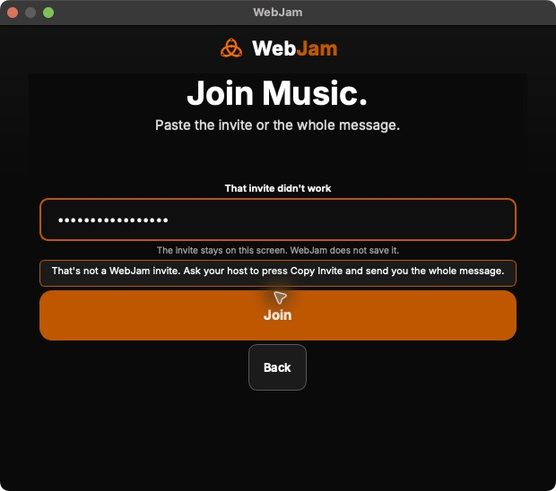

# Current WebJam package and actual Mac launcher proof

Recorded October 31, 2026, 08:19–08:32 UTC. This receipt qualifies the current
ARM package and its normal launcher. Physical two-way music remains unqualified.
It supersedes source83 package selection for this target while preserving the
[original package](HANGOUT_NATIVE_CANDIDATE_20261031.md) and
[original accessibility failure](HANGOUT_NATIVE_ACCESSIBILITY_20261031.md).

## Source and package identity

Native source is `bb40fac7fcaa032c2f19cf9af8c49ac4276d3cf1`, tree
`9f6af28b1429a71f011bf82af7dea25327613a70`, merged through
[PR409](https://github.com/rupret007/webjam/pull/409). Its reviewed and actual CI
trees match; the [readiness note](HANGOUT_NATIVE_READINESS_20261031.md) records
the separately qualified full CI and Windows controls.

Exactly one matching private package dispatch started at 07:41:16 UTC:
[run 41181580413](https://github.com/rupret007/webjam/actions/runs/41181580413),
branch `codex/private-music-test-bb40fac-20261031`. All four desktop jobs passed;
Intel completed at 08:31:05 UTC. The 08:31:37 observation contained 22 completed
jobs: 16 successful and six skipped, with no other result. Actual macOS/Windows
release-trust and publication jobs were skipped. Earlier in-progress observations
remain in the private journal. The 08:32:56 artifact observation contained these
source-bound, unexpired archives:

| Target | Artifact ID | Archive bytes | GitHub SHA256 |
| --- | --- | --- | --- |
| ARM Mac | `13035694388` | 456511553 | `f0946862d1bb40b1c88b31d7143e2031dfdc250fc03688c0f5bbdde5a5699e35` |
| Intel Mac x64 | `13036762004` | 471460999 | `bf7c7b93b20033e2f14c402046795c0152a547778e1b7985307964defeb11a76` |
| Windows x64 | `13036610720` | 610884199 | `df7bd38b1fb869ce557d288b28d009dd83755a9c20c486c1455df8374bb31dfb` |
| Linux x64 | `13035758533` | 457714132 | `308b7df2dccb1533e31c11ca2d177bb0ba28d957dbba924d40833f736e0e5df5` |

Intel/Windows/Linux identities above are official artifact metadata, not local
download, installation or physical-device proof. No additional dispatch is needed.
Signing inputs, one-hour certification, unapproved headless evidence and public
publication remain disabled. No package was re-signed or stripped of quarantine.

## Actual ARM package qualification

The ARM download's byte count and SHA256 match GitHub; ZIP CRC checks passed.
Its inner archive SHA256 is
`d8d9f68750073d548c16453311d2fe2cab857dd1f207d641be550afa4b1c8ad4`.
Bounded extraction verified safe paths, internal symlink targets, exact embedded
source and source-identical installer/readme bytes. Installer, quarantine-removal
and mobile setup scripts were not executed.

`codesign --verify --deep --strict` passed. The app and transport are arm64.
The bundled transport SHA256 is
`894239b1e6782b47f977281a2e4cdde1f554651aefb58554fb6ec343d6bc912e`,
matching its canonical manifest. The existing production verifier, with platform
signature required, executed exact-build idle `ready`/`hello`, then confirmed
clean `stopped` and no running transport. This starts no audio host or provider.

All extraction, CLI and GUI admission guards passed the unchanged load1 < 10,
swap < 80%, free/projected disk ≥ 15 GiB limits. The earlier dispatch refusal
remains recorded; no unrelated process or global cache was removed.

## Actual normal frozen GUI

Before input at 08:23:27 UTC, the OS kernel executable for PID85746 matched the
verified staged app, whose embedded source was `bb40fac`. No startup smoke flags
or other WebJam/transport processes were active.

Music → Join → `webjam://join?v=1` → Join retained the launcher and displayed the
full recovery explanation. Unlike the original83 failure, macOS accessibility
now exposes that explanation. The input remains a masked secure field.

The unmodified native snapshots demonstrate:

- [Initial refusal](../pr-assets/beta-collaboration/20261031/nativebb40-malformed-join-ax.txt): full visible recovery text is exposed.
- [Editing](../pr-assets/beta-collaboration/20261031/nativebb40-edited-join-ax.txt): stale error disappears and the pasted-invitation status returns.
- [Return-key retry](../pr-assets/beta-collaboration/20261031/nativebb40-retried-join-ax.txt): the full explanation returns and input stays masked.

Back returned to the Music launcher. Cmd-Q left the modal launcher running; its
native Quit menu item was disabled. That initial cleanup failure remains in its
original receipt. The window Close control then exited normally. At 08:25:03 the
OS inventory contained no WebJam/transport process; saved configuration size,
mtime and inode matched before launch. No process was terminated and no saved
configuration values were read or changed.

The [sanitized package/GUI receipt](../pr-assets/beta-collaboration/20261031/nativebb40-arm64-package-gui-receipt.json)
pins screenshot/snapshot hashes and the private lifecycle receipt digest. Original
failures remain separate. This is native accessibility-tree proof, not a full
VoiceOver, audibility, installation or remote-network result. No workspace,
microphone/camera capture, recording or provider was started.

## Continue toward the actual demo

Follow the
[physical music acceptance](HANGOUT_MUSIC_DEMO_ACCEPTANCE.md) with approved
device access. The Mini's read-only production CoreAudio resolver separately
found official BlackHole16ch, 16 input/output channels at 48 kHz. Discovery does
not open a stream, select a route or certify SharedTrack; its pilot remains held.
Frozen unsigned Windows remote transport still does not meet its signature
policy. Same-network invitations and browser Web Join have distinct prerequisites.

Keep the private website on source96/runtime629 during its existing eight-hour
observer. Human report review and physical ARM/Intel/Windows music, Linux, full
accessibility, capacity, legal/public-launch work and all unverified
[62 outcomes](HANGOUT_ACCEPTANCE_REQUIREMENTS.md) remain explicit. No StoryPool
application route, shared-service change or AI/TURN/trust/release activation was used.
