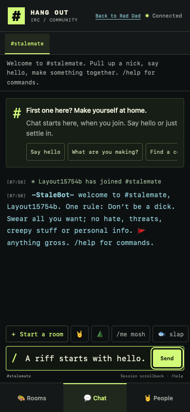

# Private demo: October 31 application evidence

Updated at 13:00 UTC. This session owns application changes directly, without a
StoryPool/Karen application route. Shared services, checkouts, locks and
operational state are untouched. All
[62 original requirements](HANGOUT_ACCEPTANCE_REQUIREMENTS.md) remain in force.

## Current private website

[Website PR178](https://github.com/rupret007/StalemateSite/pull/178) merged as
`4ed1525c84f48173077f506261cb5acd19e3c1dc`. Its reviewed final head
`a56c2ff08b9a86ba3627b8fd787baef867630fa5` has the same complete tree,
`2144677d638fee4b078a18e75892db9d75c6acdc`. Both required workflows passed;
the inspected final-head job passed 1,869 unit cases and 438 browser cases in 438
attempts, with no retry markers. Both new focused cases also passed locally.
Separate actual native Chrome 400%/200% checks demonstrated visible input/Send
and Tab/Space delivery with a saved copy retained. Original native and
intermediate CI failures remain in the
[zoom note](HANGOUT_NATIVE_BROWSER_ZOOM_20261031.md).

The invitation-only beta now runs this exact merged source as version
`a9724702-3ce5-418a-bbd4-950f2e169c9e`, deployed at 12:50 UTC. The only application
change since source 96 is chat CSS. All 65 packaged files matched tracked source
and excluded private values. All 17 effective variables, five Durable Object
bindings, five secret-binding metadata entries and runtime settings remained
exactly equal. Previous version`6293386f-31b8-4415-bf0b-f81296190a4d` remains
available for rollback. No secret value, namespace or provider setting changed.

Actual hosted WebKit passed 375×812, 390×844 and 300×299 with a rejected copy
retained in the short view. Page/body width stayed within each viewport;
input/Send corners were uncovered and input text was 16px. Captures were
inspected. One ordinary guest used real admission and a real socket. No room
was created or ordinary chat intentionally published. JSON logout returned 200,
then the protected asset returned 401. Context and browser cleanup completed.
These are browser viewport checks, separate from physical iPhone/native zoom.

The first hosted attempt remains FAILED: it assumed one WebKit Tab focuses
Send and omitted the JSON logout body, returning 403. The later run records
actual Tab targets (BODY/DIV) and uses ordinary locator focus for viewport
measurement; it makes no WebKit keyboard-pass claim. The original failure and
unconfirmed first logout remain recorded. Its browser/context closed and no
room was created; no original-session revocation is claimed. Actual native
Chrome/CI Tab/Space evidence is separate.

An authenticated read-only probe returned healthy/HTTP 200 with no issues,
storage reads only, no provider checks, state writes or notifications. Ending
deployment metadata confirmed 100% traffic on version a972 after the layout run.

## Native source and new private packages

[Native PR410](https://github.com/rupret007/webjam/pull/410) merged as
`bf24e7d4769aa8ef8ce1300ccacc7d1fe9b2fc35`. Reviewed head 7faf4ed, actual CI
checkout 619a32f and merged source share tree
`1c04fb436337987cca75054be54d3695db0db194`. All 555 tracked modules ran once in
order: 12,796 passed, 60 skipped; all 16 applicable checks passed. Earlier failures
are preserved in the [routing readiness note](HANGOUT_WEB_JOIN_READINESS_20261031.md).

Exactly one matching [private package run 41193954131](https://github.com/rupret007/webjam/actions/runs/41193954131)
completed successfully. ARM Mac, Intel Mac, Windows and Linux each passed their
actual bundled Web Join target verification. There were 16 successful jobs and
six expected skips. Signing, publication, one-hour and unapproved-headless
inputs stayed off. The sanitized receipt pins all four unexpired artifact IDs,
exact sizes and SHA256 digests. Do not dispatch another unchanged build.

The ARM download matched its published digest and ZIP integrity. Later recovered
headroom admitted extraction with 15.48 GiB projected after expansion. The sealed
app passed strict deep signature, ARM architecture, embedded source, transport
digest and canonical private-target checks through the production reader. The
actual packaged sidecar passed ready/hello in idle state and clean Stop under
the production signature policy. No installer, quarantine-removal script or
signing change ran. Keep the existing 15 GiB reserve for subsequent work.

The normal frozen app opened from that bundle; actual process path and embedded
build were checked before input. An incomplete encrypted invitation failed
before connection. Its full explanation was visible and exposed in AX, editing
cleared it, and Return-key retry restored it. Back returned to the launcher.
The original process exited on Close; a following app AX read observed a new
same-bundle launcher process. That owned replacement was closed without another
app activation/read, then OS checks confirmed no app/transport remained and
saved-settings metadata was unchanged. This observation is retained instead of
claiming cleanup from one PID alone. No music/provider or actual Web Join action
ran. Installation and physical music remain unqualified.

[Actual new-package recovery capture](../pr-assets/beta-collaboration/20261031/private-demo-progress/native-incomplete-invite.jpg)
and its AX/edit/retry/Back snapshots are included in the receipt. Older bb40
package/GUI proof remains scoped to that earlier public-target source.

## Eight-hour expiry: original failure and separately observed behavior

One normally admitted guest ran from 04:08:30 UTC, with actual natural expiry at
12:08:30.618 UTC. The original observer ended FAILED at 12:10:01.073 UTC with
`natural-expiry-socket-observation-timeout`. Its original script and receipt are
unchanged. No clock/TTL change, re-admission, manual reconnect, media, chat or
report was used in that run.

Its terminal record has the current private socket closing 4401 at +26ms and the
late same-session lobby socket closing 4401 at +47,429ms, both within the original
90-second allowance. The private room ended/hidden; the lobby became `ended`
with no replacement attempt. Expired state/asset HTTP and the original expired
token were denied401. Owned browser and idle-sleep helper cleanup completed.
The observer incorrectly required lobby `offline`; exact deployed source handles
4401 with `endSession()` and finishes in `ended`. A separate diagnostic records
these observed criteria without relabeling the original run PASS. A future
helper copy corrects the expectation but has not run; it remains bound to the
old source/runtime and must not be run against the new deployment unchanged.

Normal post-expiry reads at 12:23–12:25 UTC confirmed the then-current 100%
deployment remained source 96/runtime 629, before the later CSS-only upgrade.
The original 10500 read error is preserved separately from its successful retry.
Those expiry observations are not a new eight-hour test of version a972.

## Remaining work

1. Finish actual browser invitation, installation and physical-device use. The
   normal frozen host still selects direct-stun; its version 2 LAN route is not
   automatically exposed. Tailscale 100.x is not an eligible RFC1918 invitation.
2. Preserve AI, TURN/vault, native-trust, purchases/signing and public-release
   holds. Browser-scoped issuer bindings/exact origins remain absent. Same
   Wi-Fi and unsigned Windows do not bypass those prerequisites. Prepare the
   concrete owner decision through the existing documented plan; no activation
   is implied by this receipt.
3. Demonstrate real reciprocal music involving the ARM Mini, Intel MacBook Pro
   and Windows, retaining Linux. Record exact builds, networks, explicit capture
   consent, usable audio, errors and Stop/leave. Packages, synthetic checks and
   same-machine echo do not qualify physical music.
4. Jeff's authorized disposition of the current benign report remains separate
   from server acknowledgement. Keep other reports untouched. Continue the
   remaining 62 outcomes and receiving-site integration handoff without reducing
   legal, accessibility or capacity requirements.

[Sanitized source/artifact/expiry/deployment receipt](../pr-assets/beta-collaboration/20261031/private-demo-progress/receipt.json)
contains exact identities, geometry, original failures and scoped checks.
The community remains private; there was no public launch or paid activation.
