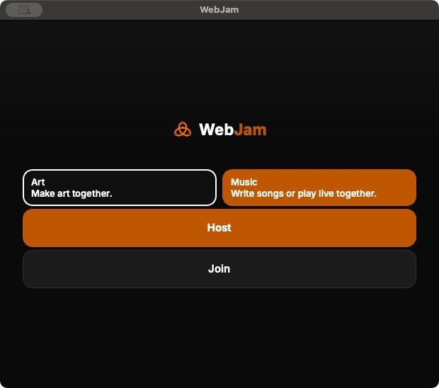
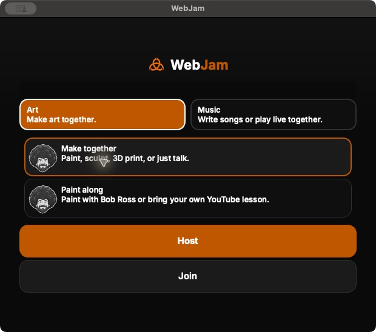

# Scoped live private-community evidence

These are actual Safari screenshots of two synthetic test guests on the private
c83 frontend, not fixture screenshots. The private messages were authored solely
for this test. The images were inspected before inclusion: the address contains
no query or invitation fragment, and no code, token, email inbox, account profile
or private meeting link is shown. Raw configuration and raw browser logs remain
outside the repository.

The receipt separates live browser observations from local fixture, generated
transport, package/signature and human-hearing evidence. The PM screenshot shows
only the post-acceptance messages. Acceptance gating and the later block/draft
outcome are recorded in the receipt; the screenshot alone does not prove them.
The Safari Option-Tab image shows its focused PM action. It is not VoiceOver
speech evidence and does not resolve the native accessibility-output omission.

All test sessions were stopped, the disposable channel was closed and the test
block/draft were cleared. No microphone/camera, music relay, AI or recording was
started. Nothing here authorizes provider activation, public entry links or a
release-hold reset. See the current private-readiness guide for remaining gates.

## Native package evidence

[native-packages-715.json](native-packages-715.json) records the four actual
715 archives, source/architecture/component checks and Mac nested signatures.
These are distinct from current physical audio and meeting acceptance. The two
idle screenshots below are actual ARM715 app captures, not design mockups.
Host/Join were not pressed; no microphone, camera, recording or provider was
activated. Matching fro icons are visible on both Art choices. The app exited
through its normal window close; its disabled startup Quit menu is recorded as
an unresolved observation. Desktop selection remained unchanged.

