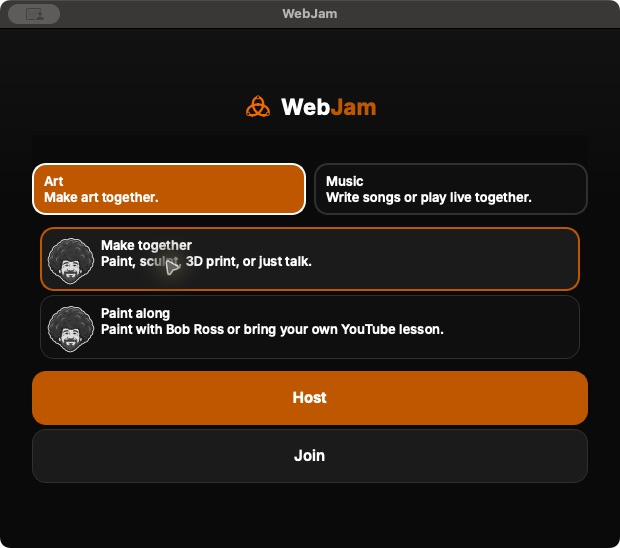
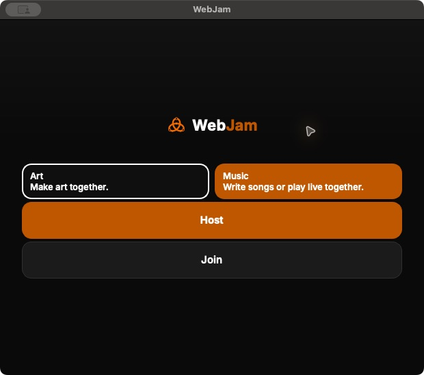

# Current native package and idle UI evidence — November 10, 2026

All four actual archives are from source
`67c7ef08e515c84eb2b0736c474ec2c4b0c21682`, private-beta target, and
[completed build 42761983020](https://github.com/rupret007/webjam/actions/runs/42761983020).
The [sanitized receipt](native-packages-67.json) records GitHub artifact IDs,
actual archive hashes, source/target/architecture checks, CRC/path checks,
generated runtime notices and all 11 pinned license-evidence entries. The missing
own-MIT copy in older `7153994` packages is fixed in these actual archives. This is a
scoped packaging check, not a complete redistribution or legal certification.

Both Mac bundles passed five strict, deep, all-architecture signature checks;
the signatures are ad-hoc, not notarized. Windows is unsigned/test-only. Its
hosted Setup install/start/uninstall and checksum checks do not prove publisher
trust or physical PC audio. Intel, Windows and Linux were inspected without
running the app locally. Existing Desktop selections remain unchanged.

The images below are actual idle Apple Silicon app captures. The running
executable was checked against the verified cache. Both Art choices show the
matching fro icon, and the Paint along description supports Bob Ross or a custom
YouTube lesson. Command-Q closed the idle app twice, with no Music executable
remaining afterward. However, the [native menu accessibility evidence](arm67-app-menu.txt)
still reports Quit disabled during the startup dialog; native menu activation
is an explicit unresolved limitation. These images are not design mockups.

Host/Join were not pressed. No microphone, camera, recording, Music relay or
Webex meeting was started. The results do not qualify a live rehearsal, physical
mobile/assistive technology, Shared Track mixing or a Webex audio handoff.
No public entrance, deployment, configuration, cap or hold changed.

## Current source and prepared private package

The [sanitized source qualification](current-source-qualification.json) records
website PR253, upstream WebJam PR466, exact CI/tree identities and the prepared
70-asset private package. It also records actual current-tree application/workerd
provider-start CI and the verified eight-file integration toolkit. These browser
source changes do not rebuild or relabel the native `67c7ef0` archives above.

The prepared site is not uploaded or admitted. The owner continuity decision for
the missing relay-hold record remains pending; other controls remain unchanged.
Physical Music, WAV/MP3 Shared Track mixing and Webex video/audio handoff are still
required. Neither source CI nor an idle screenshot establishes those journeys.
