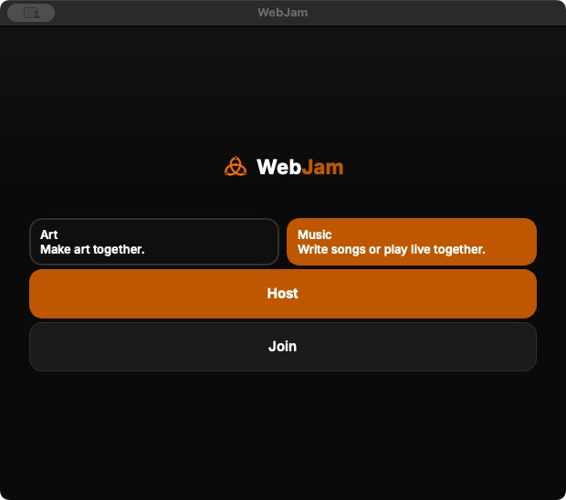

# Current native package evidence: AE49

The source is `ae49c915070f2951db9ff441c23c7f0a9d90ce1b`, merged by
[WebJam PR468](https://github.com/rupret007/webjam/pull/468) as
`3eb71e9892e72062ea6991ccd76a8805f85497a1`. The actual merged tree equals the
reviewed head and tested synthetic merge. This updates package evidence;
**it does not qualify the full band rehearsal**.

[Sanitized receipt](qualification.json) ·
[Current readiness](../../../../hangout-internal/HANGOUT_CURRENT_PRIVATE_READINESS_20261108.md)

| Evidence | Result | Limit |
| --- | --- | --- |
| Source CI | 12,985 passed, 60 existing skips; all 567 modules exactly once; nine startup cases pass. Browser/Worker checks pass. | Source and generated tests do not prove physical media. |
| [Native build](https://github.com/rupret007/webjam/actions/runs/42888556613) | All four desktop jobs pass. Intel attempt 1 stopped on TLS EOF35 while downloading pinned Opus; one failed-jobs-only retry passed with security checks and source unchanged. | Original failure and complete successful logs are retained separately. |
| ARM Mac | Actual archive identity, CRC/paths, private target, architecture, component/license/notices and five strict signature checks pass. Actual startup and enabled native Quit close pass. | Ad-hoc, not notarized. Startup/menu evidence is not a live Music, Shared Track or Webex result. |
| Intel Mac | Actual archive downloaded and inspected on the Intel MacBook; the same checks and five strict signatures pass. | Cache only; app not locally opened or selected. |
| Windows | Actual archive identity, Setup/ZIP checksums, CRC/paths, x64 header, private target, transport hash and eleven license checks pass. Hosted install/start/uninstall passes. | Unsigned test-only; no local execution or physical Windows media claim. |
| Linux | Current hosted build and frozen workflow checks pass; artifact identity is recorded. | Current archive not independently inspected locally; no physical Linux media claim. |

## Observed ARM startup

This is the actual package screenshot, not a generated mockup. Its hash and the
[enabled native Quit accessibility state](arm-native-quit.ax.txt) are in the
receipt. No native-menu screenshot is claimed.

A later Join probe incorrectly treated a valid manual hostname as malformed
input. It requested audio startup; Leave was requested immediately and
Stopped/NotConnected plus final process exit were observed. The test hostname
was cleared to loopback, preserving other post-attempt preferences. There was no
pre-test connection snapshot, so exact prior role/connection restoration is not
claimed. One observation reopened a closed app. That probe does not qualify
malformed-input refusal, in-process return, workspace native Quit, historical
absence of capture/network activity or successful music. Future UI checks need
a private settings preimage, source-known input fixtures and process-exit checks
before observing an old app handle. Raw logs and recovery settings stay private.

## Next use and recovery

The inspected apps remain separate caches. Existing Desktop selections were
preserved; do not assume a familiar icon opens AE49. Before a trial, confirm the
selected build through normal UI and fresh device, trust, resource and existing
provider/release checks. Never bypass quarantine or install a new driver for this
qualification. BlackHole 16ch is already installed on the MacBook.

Keep the qualified older packages and dated receipts for rollback. Generated old
Mac ZIP archives were copied to the external drive with full SHA/CRC verification
and durable copy evidence before removing originals. An old Linux outer ZIP was
retired only after proving it contained exactly the retained, hash/CRC-verified
inner archive. Restore a retained backup exclusively to its recorded original
cache path, verify its full size/hash, then use normal UI. Do not replay completed
inspectors, uploads, switches or cleanup scripts. Private operational paths and
backup/config files are intentionally absent here.

The current private site, issuer, public navigation, caps, holds, recording and
AI settings are unchanged. Continue all 62 requirements; current physical Music,
WAV/MP3 Shared Track, Webex video/audio handoff and newcomer acceptance remain.
