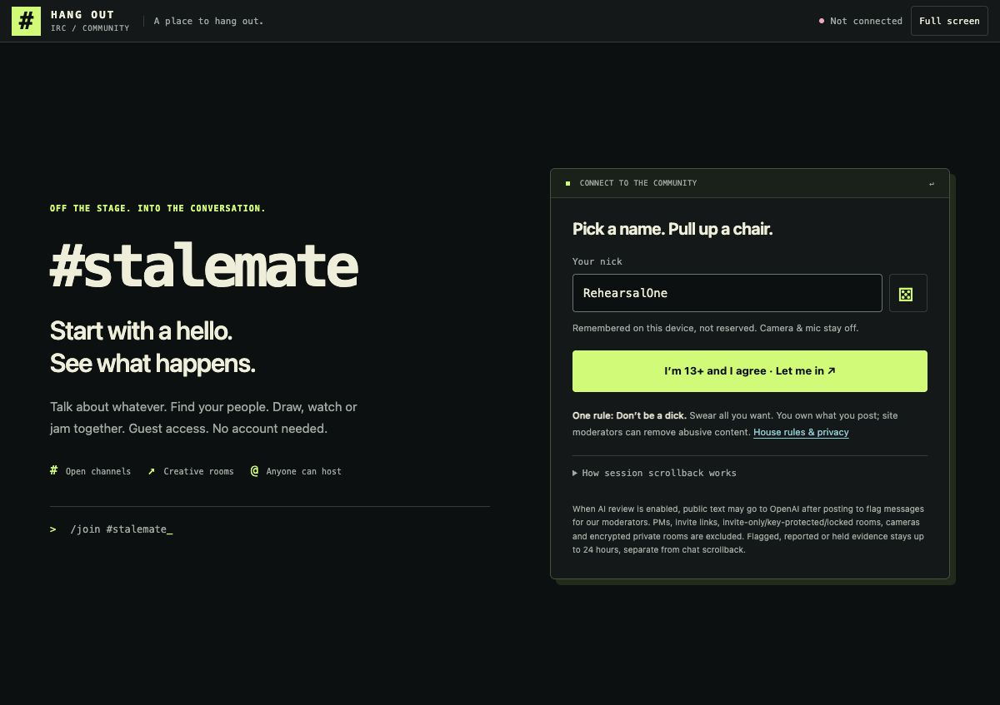
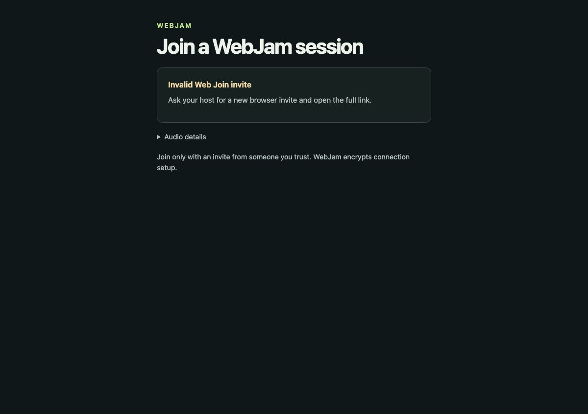

# November 10 private frontend delivery

[Sanitized receipt](receipt.json) records the actual private switch, exact backend
and configuration preservation, 31 served static-file hashes and scoped browser
observations. No credentials, private invitation, operational config or tailnet
address is included. The original failed HTTP observer is retained locally; a
normal descriptive WebJam request identity qualified the corrected readback.

The reviewed 70-file package is **not** a claim that all 70 assets were read back.
The 31 checked JS/MJS/CSS/SVG files include the selected-pair audio correction.
The normal isolated HTTP session was logged out and denial verified afterward.

| Admitted nickname prejoin | Missing Music invitation |
| --- | --- |
|  |  |

These are Chrome observations on the Mini, not physical mobile, screen-reader,
Windows, valid Music invitation, microphone or connected media acceptance. The
single guest-agreement confirmation remains pending. Current Music, desktop
Shared Track, Webex video/manual exclusive audio handoff, remaining platform,
newcomer, capacity and operator/legal outcomes remain unfinished.

Immediate rollback is the prior private site version `49f19821`; the older
`2c5c81e5` and issuer `4db649fa` remain retained. No rollback was performed.
Rollback still requires fresh resource/configuration checks and restoration
verification; this receipt is not an instruction to replay completed helpers.
